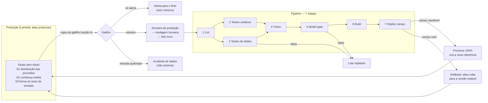

# Desenho do pipeline — Proposta C · Do mensal ao contínuo

**Aula 2 · CI/CD para IA** — dupla `@mlpelegrini` e `@nelsonlouzada`

> Retreinar quando precisa, não quando o calendário manda.

## 1. O cenário e o que muda

O classificador rotula avaliações de produto como *positiva*, *negativa* ou *neutra*. Hoje ele é
retreinado à mão uma vez por mês, e o deploy é um engenheiro copiando o arquivo do modelo para o
servidor (nível 0 de maturidade de MLOps).

| | Hoje (manual) | Proposta C (contínuo) |
|---|---|---|
| Quem dispara o retreino | O calendário (1×/mês) | Sinais de produção ou mudança de código |
| Validação antes de servir | Olho humano | Testes de dados + model gate automáticos |
| Deploy | Cópia de arquivo | Versão imutável do Lambda + alias `producao` |
| Depois do deploy | Ninguém olha o modelo | Canary + monitoramento + rollback automático |
| Rollback | Achar o arquivo antigo | Mover o alias para a versão anterior (segundos) |

O desafio da proposta C: **em produção quase não há rótulo**. Ninguém diz ao sistema se a previsão
estava certa. Por isso a observabilidade usa sinais que **não dependem de rótulo**.

## 2. O ciclo completo

Os quatro blocos do slide estão todos aqui: **sinal em produção → gatilho de retreino → pipeline
(7 etapas) → deploy ou rollback**. Depois do deploy, a nova versão volta a ser observada, e o ciclo
se fecha.

## 3. As sete etapas, com critério concreto

Cada critério cabe num `if` que uma máquina avalia. A coluna "No repositório" diz onde o critério já
existe ou onde precisa ser criado.

| # | Etapa | O que valida | Critério de aprovação | Se falhar | No repositório |
|---|---|---|---|---|---|
| 1 | Lint | Estilo e imports do código de treino e serviço | `ruff check` e `ruff format --check` com zero erros | Bloqueia o PR | `ci-classificador.yml` (job 1) |
| 2 | Testes unitários | Limpeza de texto (acentos, emojis, URLs, vazio) | 100% dos testes de `test_texto.py` passam | Bloqueia o PR | `ci-classificador.yml` (job 2) |
| 3 | Testes de dados | Se o lote pode virar modelo: schema, volume, ruído e distribuição | Schema `texto,rotulo`; nenhum texto vazio; ≥ 300 linhas; ≤ 10% de textos só com emojis; cada classe a ≤ 10 p.p. da referência (40/35/25); média de palavras a ≤ 25% da base de treino | Bloqueia: o lote é rejeitado e não treina. Desvio de classe entre 5 e 10 p.p. só **alerta** | `test_dados.py`; a regra de tamanho do texto é o **desafio** |
| 4 | Treino | Se o treino é reprodutível e gera os artefatos | `treino.py` termina com código 0 e gera `modelo.joblib` + `metricas.json` | Bloqueia; o erro aparece no log do job | `treino.py` |
| 5 | Model gate | Se o candidato é bom o bastante e não pior que a produção | F1 macro ≥ 0,80; F1 de **cada** classe ≥ 0,70; queda ≤ 0,02 em relação a `producao.json` | Bloqueia o deploy (`exit 1`); o resumo mostra candidato vs. produção | `model_gate.py` |
| 6 | Build | Se o modelo aprovado vira uma imagem que sobe | `docker build` sem erro, com o `modelo.joblib` do job 5 e a versão (SHA) gravada na imagem | Bloqueia o deploy | `ci-classificador.yml` (job 6), `Dockerfile` |
| 7 | Deploy | Se a versão nova se comporta bem com tráfego real | Canary com 10% do tráfego: taxa de erro ≤ 2% e até 1 p.p. acima da estável; latência p95 ≤ 1,5× a estável; distribuição de previsões a ≤ 15 p.p. da estável. Smoke test responde 200 | **Rollback automático**: o alias `producao` volta 100% para a versão estável | `canary-classificador.yml`, `canary_check.py` |
| — | Observabilidade | Se o modelo em produção continua saudável sem rótulo | Sinais S1–S3 dentro das faixas da seção 4 | Alerta, retreino ou incidente, conforme a regra da seção 4 | **A criar** (seção 7) |

**Por que um piso por classe (etapa 5):** a média esconde uma classe ruim. No lote novo, o F1 macro
cai para 0,73, mas o problema real é a classe *neutra*, que cai para 0,58. Sem o piso, uma
queda de F1 macro pequena poderia passar com a *neutra* quebrada.

## 4. Observabilidade: os três sinais sem rótulo

Cada resposta do serviço já devolve `rotulo`, `confianca` e `versao` (`servico.py`). Basta registrar
essas três coisas e o tamanho do texto de entrada a cada requisição e agregar por janela de 24 horas.

A **referência** de cada sinal é medida no conjunto de validação no momento em que a versão é
promovida, e fica gravada junto com `producao.json`.

| Sinal | O que mede | Referência hoje | Alerta | Crítico |
|---|---|---|---|---|
| **S1 · Distribuição das previsões** | % de cada rótulo previsto na janela | 42% positiva · 32% negativa · 26% neutra (previsões na validação) | Uma classe a mais de 5 p.p. da referência | Uma classe a mais de 10 p.p. da referência (ex.: *neutra* < 16%) |
| **S2 · Confiança média** | Média de `confianca` e % de previsões com confiança < 0,5 | 0,80 de média · 4,7% abaixo de 0,5 (validação) | Queda de 0,05 na média | Queda de 0,10 na média **ou** > 20% das previsões com confiança < 0,5 |
| **S3 · Forma do texto de entrada** | Média de palavras após `limpar()` e % de textos só com emojis | 11,2 palavras · 2% só emojis | Média de palavras a mais de 15% da referência **ou** só emojis > 5% | Média a mais de 25% **ou** só emojis > 10% |

### Regra de gatilho: o que dispara o retreino e o que só alerta

Todas as regras olham **3 janelas diárias seguidas**, para que um pico isolado não dispare nada.

| Situação | Decisão | Por quê |
|---|---|---|
| Um sinal em **alerta** | **Só alerta** (mensagem para o time) | Variação normal do negócio; um sinal sozinho não prova que o modelo piorou |
| **S1 ou S2 crítico**, com S3 normal | **Retreino** | A entrada parece a mesma, mas o modelo responde diferente: indica mudança no comportamento dos clientes (*concept drift*) |
| **S1 e S2 críticos juntos** | **Retreino prioritário** | Duas evidências independentes de que o modelo perdeu a referência |
| **S3 crítico** (ex.: só emojis > 10%) | **Incidente de dados, não retreina** | A entrada mudou de forma; pode ser um bug na coleta. Retreinar com dado quebrado ensina o modelo a errar. Primeiro investiga a origem |
| Nenhum sinal crítico por **90 dias** | **Retreino de manutenção** | Rede de segurança: nenhum modelo fica parado para sempre, mas o calendário vira exceção, não regra |

### Como o modelo novo volta pelo mesmo pipeline

1. O gatilho separa uma **amostra de 600 textos** da janela que disparou o retreino.
2. Pessoas do time **rotulam** a amostra. É o único ponto humano do ciclo, e é necessário: sem
   rótulo, não há como treinar nem medir.
3. A amostra rotulada é somada à base atual e entra como lote novo num **Pull Request**. A partir daí
   é o pipeline normal: CODEOWNERS pede revisão, as sete etapas rodam, e o lote só vira modelo se
   passar nas etapas 3 e 5.

## 5. Rollback: se o modelo novo piorar depois do deploy

O rollback não depende de achar arquivo antigo: cada deploy é uma **versão imutável** do Lambda,
e quem recebe o tráfego é o **alias `producao`**. Voltar é mudar o alias de lugar.

| Momento | Como detecta | O que faz | Tempo |
|---|---|---|---|
| **Canary** (10% do tráfego) | `canary_check.py`: erro, latência p95 e distribuição de previsões contra a estável | Automático: `trafego.sh <versão estável>` | Segundos, na mesma execução do workflow |
| **Primeiros 7 dias a 100%** | Sinais S1–S3 da nova versão contra a referência da versão **anterior** | Automático se S1 ou S2 ficarem críticos por 1 janela: `trafego.sh <versão anterior>` | Até 24 h (uma janela) |
| **Depois dos 7 dias** | A nova versão vira a referência | `producao.json` é atualizado por PR com as métricas da versão promovida | — |

A versão anterior **nunca é apagada** durante a janela de 7 dias, para que o rollback seja só mudar
o ponteiro. Esta é a métrica DORA de **MTTR** aplicada a modelos: o tempo até reverter para o modelo
anterior.

## 6. Aplicando ao lote novo: ele vira modelo?

O lote de 20 mil avaliações (no repositório, `lote-novo.csv`, com 600 linhas) passa no schema, mas:

| Checagem | Base de treino | Lote novo | Resultado |
|---|---|---|---|
| Textos só com emojis | 2% | **28%** | ❌ Bloqueia na etapa 3 (máx. 10%) |
| Classe *neutra* | 24% | **9%** | ❌ Bloqueia na etapa 3 (desvio de 16 p.p. da referência de 25% > 10) |
| Classe *positiva* | 40% | **52%** | ❌ Bloqueia na etapa 3 (desvio de 12 p.p. > 10) |
| Média de palavras | 11,2 | **8,1** (−28%) | ❌ Bloqueia com o limite de 25% deste desenho |
| F1 macro (se treinasse) | 0,82 em produção | **0,73** | ❌ Bloquearia na etapa 5 (< 0,80) |
| F1 da *neutra* (se treinasse) | 0,78 em produção | **0,58** | ❌ Bloquearia na etapa 5 (< 0,70) |

**Decisão: o lote não vira modelo.** Ele é barrado **primeiro na etapa 3** (testes de dados), antes de
gastar treino: 4 das 9 checagens falham. Na Parte 2, os números acima foram confirmados rodando o
pipeline, e o gate reprovou com F1 macro 0,731 e *neutra* 0,583, como previsto no slide.

**E se esse lote chegasse em produção?** Passamos o lote pelo modelo atual para simular os sinais:

| Sinal | Referência | Com o lote novo | Estado |
|---|---|---|---|
| S1 · *neutra* prevista | 26% | **3,8%** (e *negativa* sobe de 32% para 57%) | 🔴 Crítico |
| S2 · confiança < 0,5 | 4,7% | **29%** (média cai de 0,80 para 0,71) | 🔴 Crítico |
| S3 · só emojis / palavras | 2% / 11,2 | **28% / 8,1** | 🔴 Crítico |

Pela regra da seção 4, **S3 crítico manda abrir incidente de dados, não retreinar**, mesmo com S1 e S2
críticos. Retreinar com esse lote ensinaria o modelo a classificar emoji como *negativa*. O caminho
certo é investigar a coleta.

**Atenção ao desafio do roteiro:** o limite de ±30% na média de palavras **não** barraria este lote,
porque a queda medida é de 28%. Por isso este desenho usa **25%**. A alternativa é contar palavras no
texto original, onde emojis contam como palavras, mas aí a regra deixa de pegar justamente o lote
que deveria pegar.

## 7. O que já existe e o que falta

| Peça | Situação |
|---|---|
| Etapas 1 a 6 no CI | ✅ `ci-classificador.yml` |
| Deploy com versão imutável e alias | ✅ `deploy-classificador.yml`, `publicar.sh`, `trafego.sh` |
| Canary com rollback automático | ✅ `canary-classificador.yml`, `canary_check.py` (Aula 4) |
| Regra de tamanho do texto na etapa 3 | ✅ `test_tamanho_medio_do_texto` em `test_dados.py` (desafio da Aula 2) |
| Registro dos sinais por requisição | ⬜ Log estruturado em `servico.py` (vai para o CloudWatch Logs) |
| Agregação diária e regra de gatilho | ⬜ Script que lê os logs e aplica a tabela da seção 4 |
| Workflow de retreino disparado por sinal | ⬜ `workflow_dispatch`/agendado que roda o script de gatilho |
| Referência dos sinais por versão | ⬜ Gravar S1–S3 da validação junto com `producao.json` |
| Janela de 7 dias com rollback por sinal | ⬜ Extensão do canary, depois da promoção |
